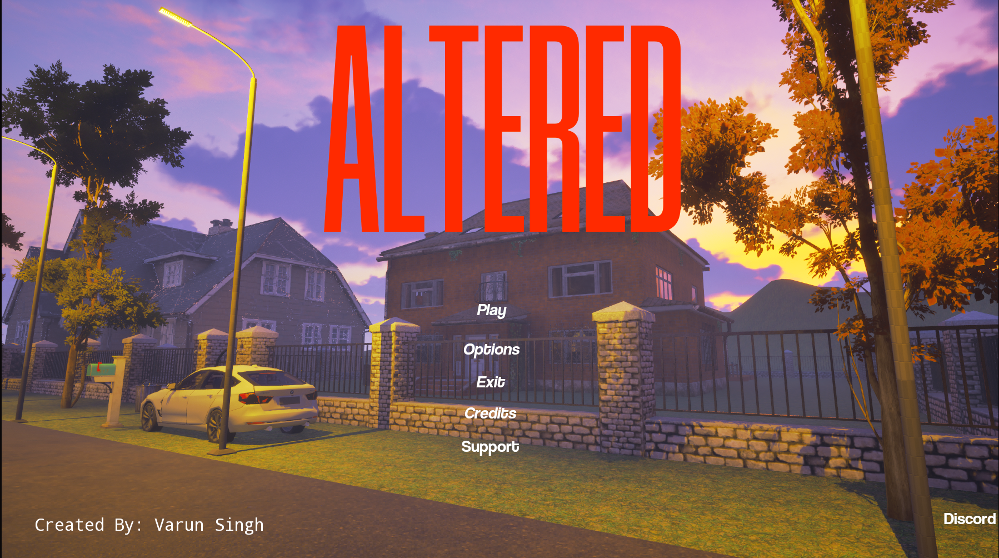
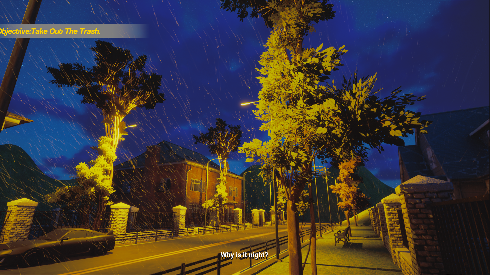
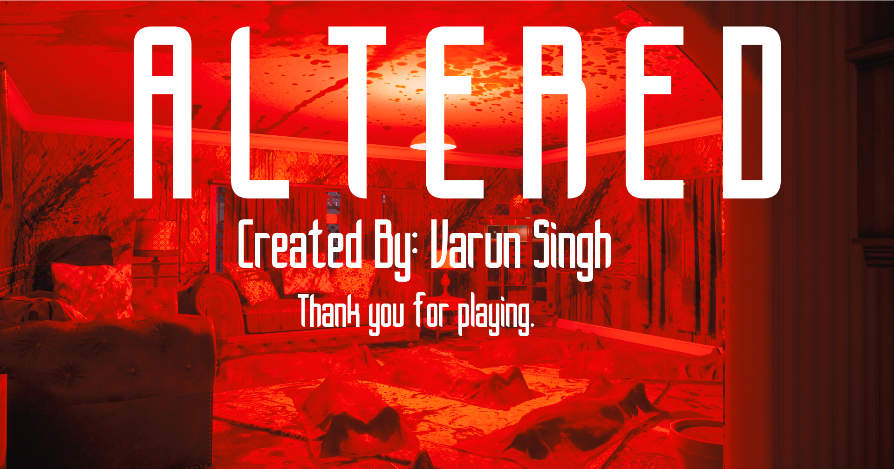
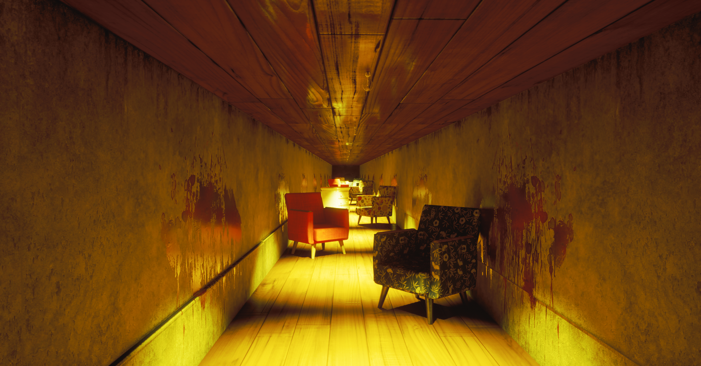
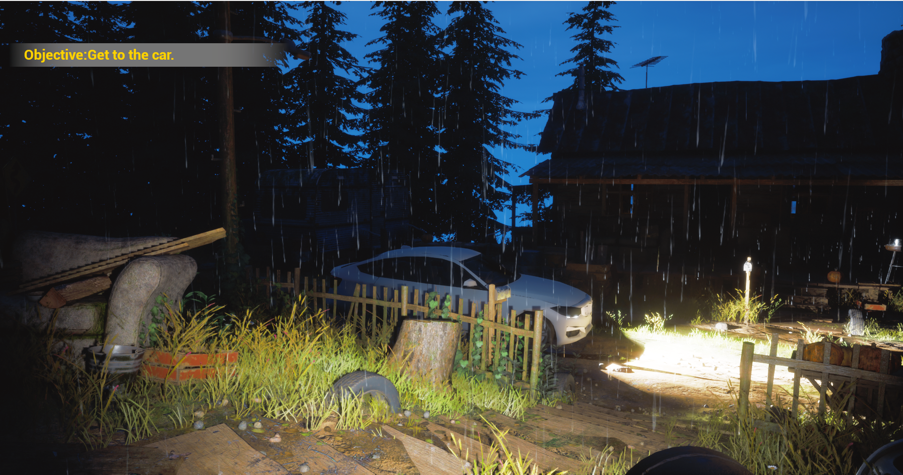
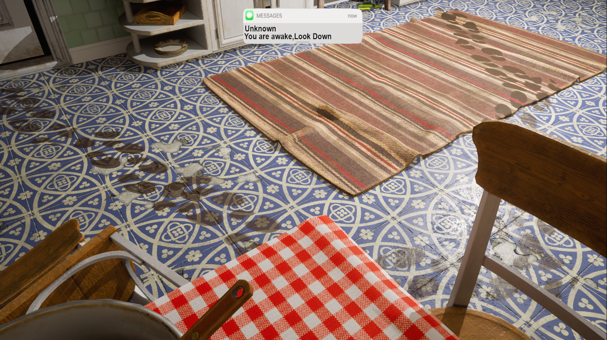
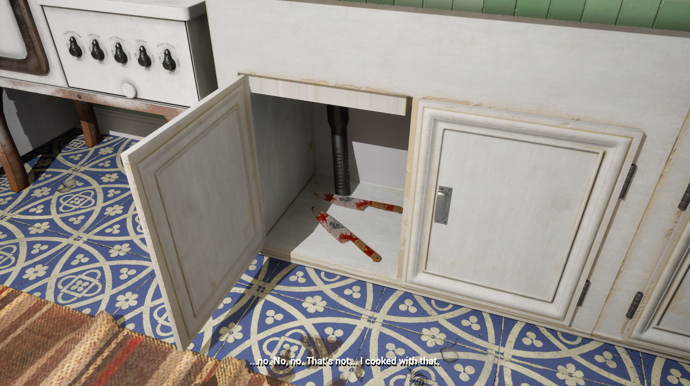

# ALTERED
### A Psychological Horror Experience

  

  <strong>Developed by Afnex Studios</strong> 
  Built with Unreal Engine 5.6

---

## About the Project

**Altered** is a first-person psychological horror game developed using Unreal Engine 5.6.

The project focuses on creating an immersive horror experience through environmental storytelling, interactive gameplay, atmospheric environments, and scripted psychological horror sequences.

Developed primarily using **Unreal Engine Blueprint Visual Scripting**, the project includes custom gameplay systems, player mechanics, interaction logic, and scene-specific events.

## Gameplay Features

- **First-Person Movement:** Custom player movement mechanics including sprinting, crouching, sliding, jumping, and zoom.
- **Interaction System:** Reusable interaction architecture built using Blueprint Interfaces.
- **Interactive Environments:** Interactions with doors, switches, lights, notes, objects, and environmental elements.
- **Psychological Horror:** Dissociation mechanics, scripted scares, environmental events, and immersive sequences.
- **Gameplay Progression:** Trigger-based events, objectives, and scripted transitions.
- **Enhanced Input:** Player input configuration using Unreal Engine's Enhanced Input System.
- **Atmospheric Environments:** Environmental lighting, weather, and visual storytelling.

## Technical Overview

| Category | Technology |
|---|---|
| Game Engine | Unreal Engine 5.6 |
| Gameplay Programming | Blueprint Visual Scripting |
| Input System | Enhanced Input |
| Interaction Architecture | Blueprint Interfaces |
| Version Control | Git & Git LFS |
| Development Studio | Afnex Studios |

## Screenshots

### Main Menu

  

### Environments & Atmosphere

  

  

  

### Psychological Horror & Gameplay

  

  

  

### Environmental Storytelling

  

  

---

## Repository Contents

This repository contains a selected snapshot of the gameplay implementation developed for Altered.

It includes:

- Core GameInstance and GameMode Blueprints
- Player movement Blueprint
- Enhanced Input Actions and Mapping Contexts
- Gameplay actors and triggers
- Blueprint Interfaces
- Interaction systems
- Scene-specific gameplay mechanics
- Development screenshots

**Important:** This is a code-focused Blueprint snapshot, not the complete playable Unreal Engine project. Maps, marketplace assets, meshes, textures, audio, and other dependencies are intentionally excluded.

Some Blueprints may therefore require assets from the original project to function correctly.

## Development

Altered is an ongoing independent game development project. Its gameplay systems and mechanics are developed and iterated on using Unreal Engine's Blueprint Visual Scripting environment.

The project serves as a practical exploration of gameplay programming, interaction architecture, event-driven systems, and atmospheric game design.

---

  <strong>ALTERED</strong> 
  Afnex Studios 
  <em>Created with Unreal Engine 5.6</em>

